<p align="center">
  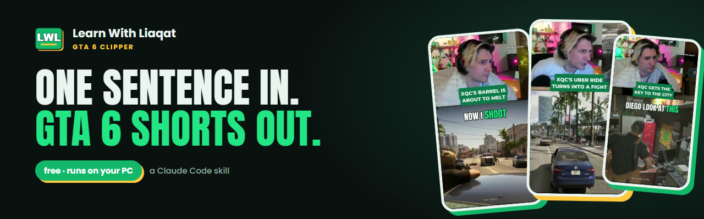
</p>

<h1 align="center">Learn With Liaqat · GTA 6 Clipper</h1>

<p align="center">
  <b>Type one sentence in Claude Code. Get finished 9:16 GTA 6 Shorts from live streams and videos.</b><br>
  It finds the loud, chat-heavy moments, frames the streamer and the game, adds word-by-word captions and a hook, and waits for your approval.
</p>

<!-- TODO: put the video URL in the first link below when the video is published -->
<p align="center"><b><a href="#how-it-works">▶ Watch how it works (video soon)</a></b> &nbsp;·&nbsp; <b><a href="https://www.youtube.com/@LearnWithLiaqat">Learn With Liaqat on YouTube</a></b></p>

<table align="center">
  <tr>
    <td align="center">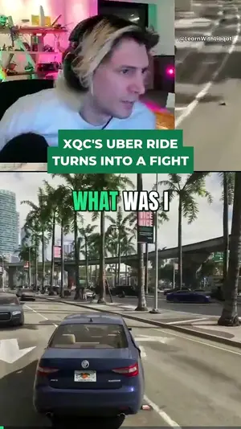<br><sub><b>xQc</b> · Uber ride turns into a fight · 22 s</sub></td>
    <td align="center">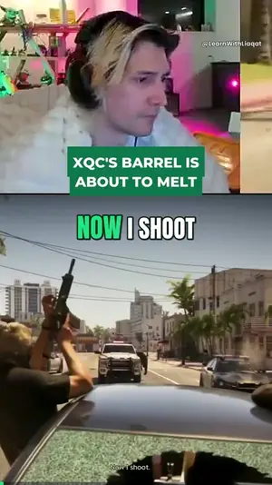<br><sub><b>xQc</b> · barrel is about to melt · 26 s</sub></td>
    <td align="center">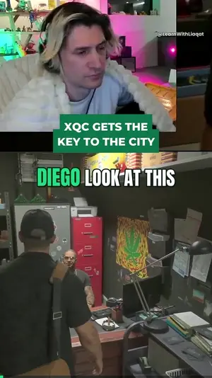<br><sub><b>xQc</b> · gets the key to the city · 24 s</sub></td>
  </tr>
</table>

<p align="center"><sub>Made by the app from one public GTA 6 stream by xQc (YouTube, 20 Nov 2026). Clips belong to their creators (see <a href="NOTICE.md">NOTICE</a>).</sub></p>

---

## Install in one sentence

Open Claude Code and paste:

```
Install the liaqat-gta6-clipper skill from https://github.com/liaqateagle/gta6-clipper
```

then:

```
Set up the liaqat-gta6-clipper skill on this PC
```

That installs the skill and sets it up in about 3 minutes, into your global Claude skills folder (`~/.claude/skills/liaqat-gta6-clipper`), so it works from any folder. If it finds an NVIDIA graphics card it also downloads about 2 GB of GPU packages (an optional speed-up; without a card it uses the CPU and nothing else changes).

**Using OpenCode instead of Claude Code?** The same two sentences work: open OpenCode in any folder and paste them. OpenCode puts the skill in `~/.config/opencode/skills/liaqat-gta6-clipper` and finds it from there. Its free models work with no account. In the app, choose **Settings > AI tool > OpenCode**. Free models pick weaker moments than Claude, so review before you post. Want no AI at all? Choose **No AI** and it still makes Shorts, cut on chat and loudness spikes.

<details>
<summary>Install by hand (Windows, macOS, Linux)</summary>

Clone it (`git clone https://github.com/liaqateagle/gta6-clipper ~/.claude/skills/liaqat-gta6-clipper`) or copy this folder into `~/.claude/skills/liaqat-gta6-clipper` (or any folder you run Claude Code in), then:

#### Install (Windows, macOS, Linux; Python 3.9 to 3.12)

Open a terminal in the skill folder, then:

| Step | Windows (PowerShell) | macOS (Terminal) | Linux (Debian/Ubuntu) |
|---|---|---|---|
| ffmpeg + ffprobe | `winget install Gyan.FFmpeg` | `brew install ffmpeg` | `sudo apt install ffmpeg` |
| Python venv | `py -3.12 -m venv .venv` | `python3 -m venv .venv` | `python3 -m venv .venv` (`sudo apt install python3-venv`) |
| Activate | `.venv\Scripts\activate` | `source .venv/bin/activate` | `source .venv/bin/activate` |
| Libraries (includes yt-dlp + deno) | `pip install -r requirements.txt` | same | same |

- Open a NEW terminal after installing ffmpeg. Check: `ffmpeg -version`, `python -m yt_dlp --version`. Every script stops with the install line above if ffmpeg is missing.
- GPU is optional. Windows/Linux with an NVIDIA card: `pip install -r requirements-gpu.txt` (Windows is wired in; on Linux also `export LD_LIBRARY_PATH=$(python -c "import nvidia.cublas.lib,nvidia.cudnn.lib,os;print(os.path.dirname(nvidia.cublas.lib.__file__)+':'+os.path.dirname(nvidia.cudnn.lib.__file__))")`). Mac (Intel or Apple Silicon) and no-GPU PCs: nothing to do, transcription falls back to CPU int8 on its own (model "base").
- Colour emoji in captions need Segoe UI Emoji (Windows), Apple Color Emoji (Mac) or `sudo apt install fonts-noto-color-emoji` (Linux); without it the emoji style is skipped, nothing breaks. Caption fonts ship in `fonts/`.
- Always run with `python` from the venv (the skill calls `sys.executable`, never a hard-coded path).


</details>

## How it works

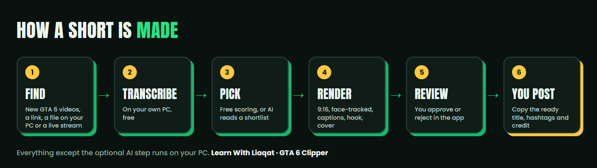

1. **You type one line.** `make 10 GTA 6 Shorts`, or `clip kaicenat live`, or paste a YouTube, Twitch or Kick link.
2. **It finds and transcribes.** New GTA 6 videos or a live stream, transcribed on your own PC for free.
3. **It picks the moments.** Loudness, chat speed and keywords score every window. Optionally an AI reads a shortlist and widens the good ones.
4. **It renders.** 9:16, face-tracked cam on top, game below, word-by-word captions, a hook title, a cover and ready-to-paste post text.
5. **You review.** One Short at a time: approve or reject. Nothing is ever posted: this edition only makes clips.
6. **You post it yourself.** Copy the ready-made title, hashtags and credit.

Want a change? Open a Short and say it in plain words: *"end 2 s earlier"*, *"bigger captions"*, *"new hook"*. The original is kept.

## The app

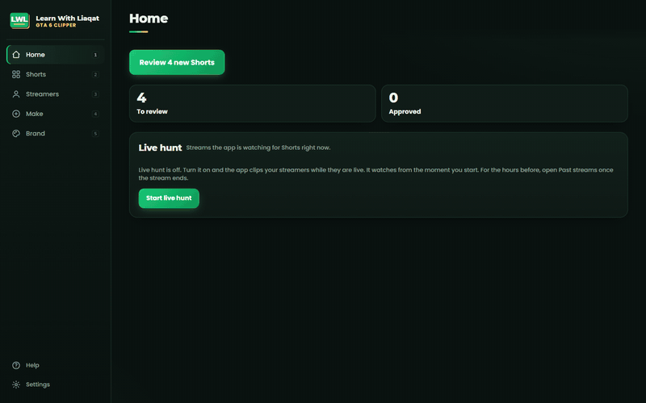

Start it any time with `python app.py <your workspace folder>` (it opens http://localhost:8765).

<table>
<tr>
<td width="50%">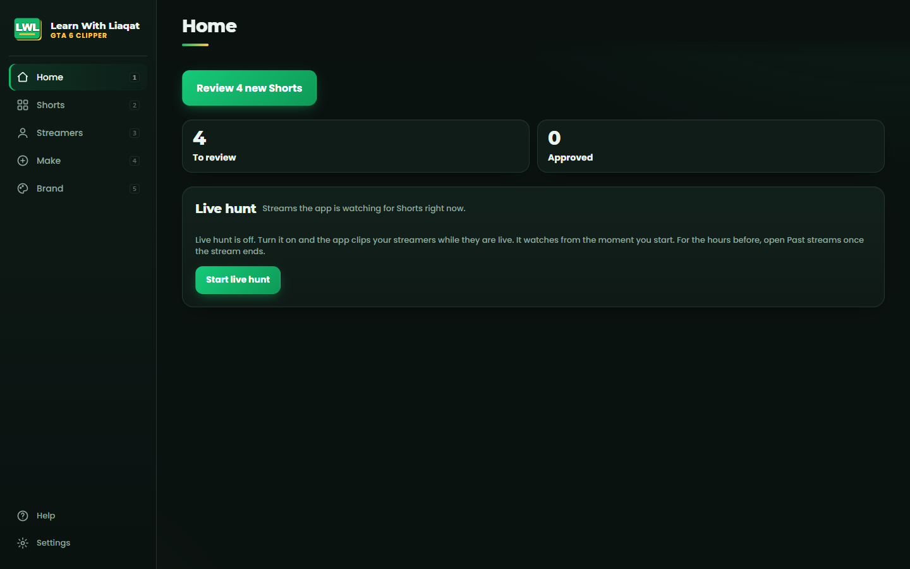<br><b>Home.</b> What needs review, what is approved, what the live hunt is watching.</td>
<td width="50%">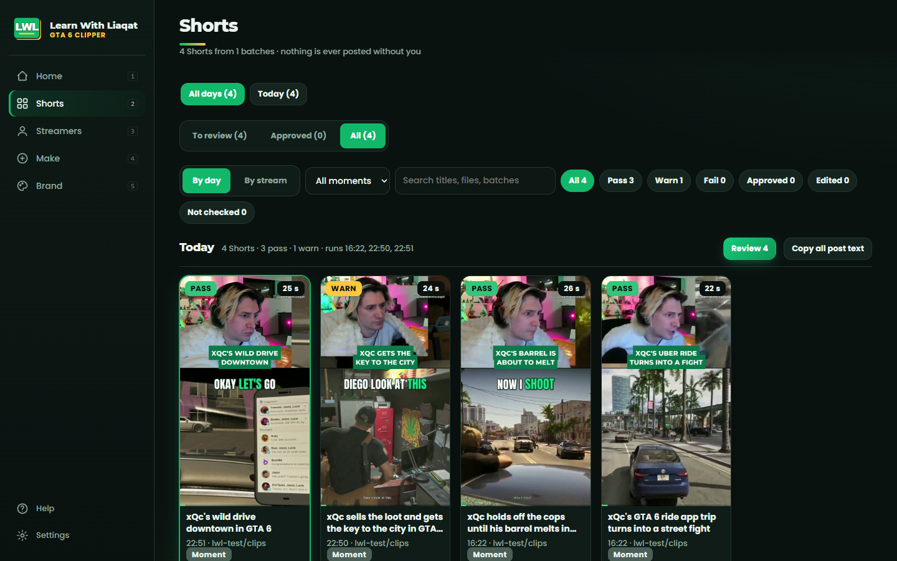<br><b>Shorts by day.</b> Every Short with a quality check (pass, warn, fail) and filters.</td>
</tr>
<tr>
<td>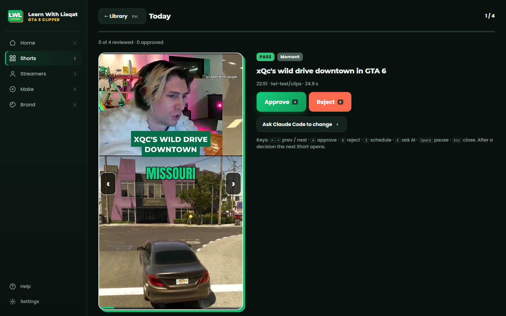<br><b>Review.</b> One Short at a time. A approves, X rejects, arrows move on.</td>
<td>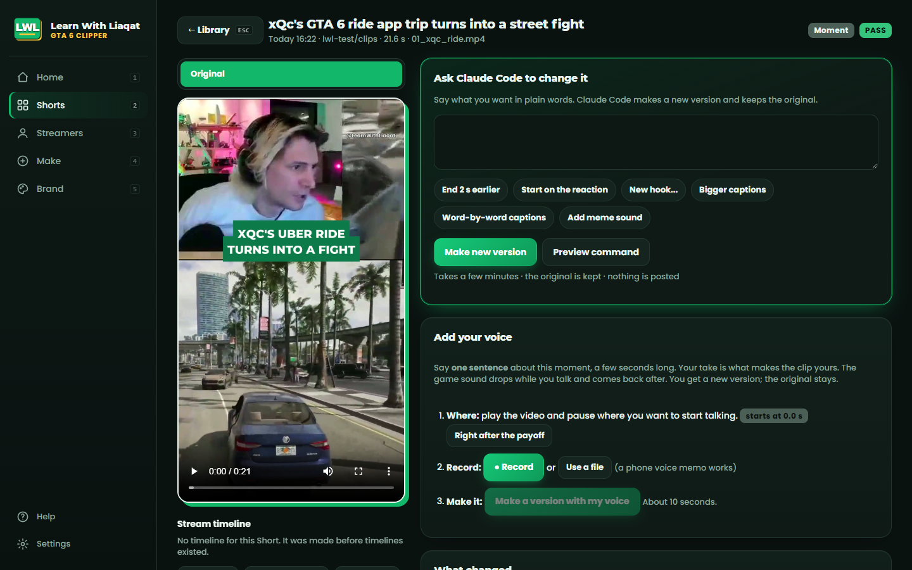<br><b>One Short.</b> Ask the AI to change it in plain words. The original is kept.</td>
</tr>
<tr>
<td>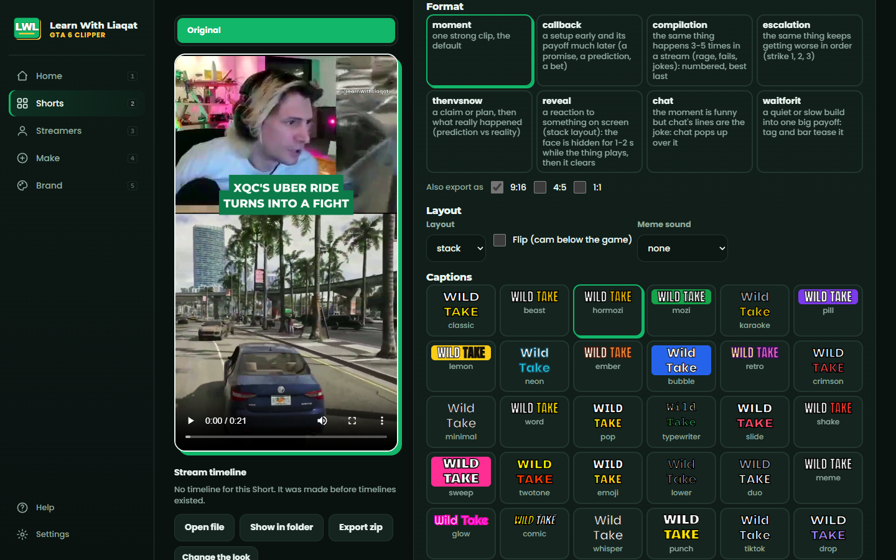<br><b>Look tab.</b> Formats, layouts, caption themes, meme sounds, extra aspect ratios.</td>
<td>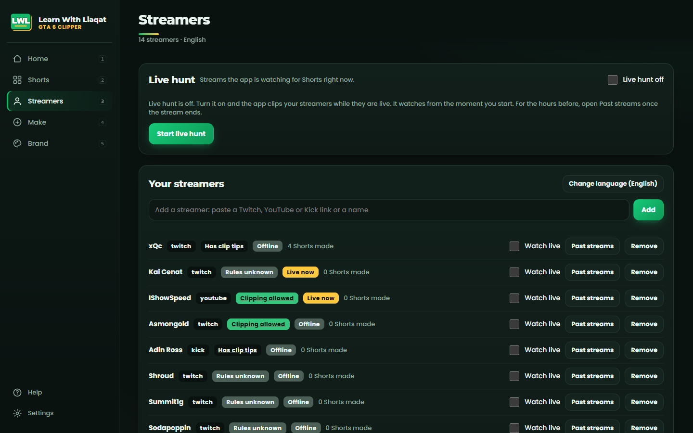<br><b>Streamers.</b> Add a Twitch, YouTube or Kick link or a name; tick "Watch live".</td>
</tr>
<tr>
<td colspan="2">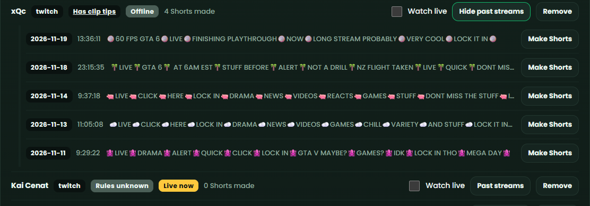<br><b>Past streams.</b> Missed the live? Open a streamer's last 5 streams (Twitch, Kick, YouTube) and click <b>Make Shorts</b>. Or paste any stream or VOD link.</td>
</tr>
<tr>
<td colspan="2">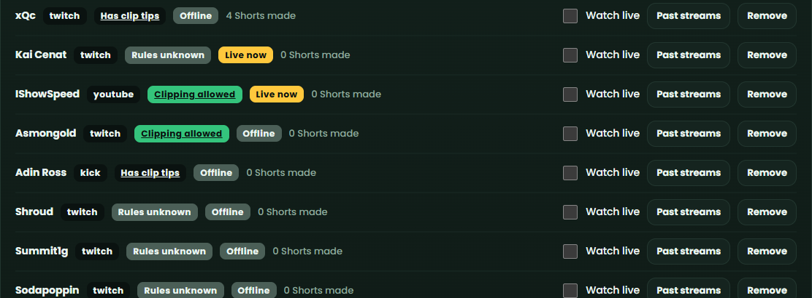<br><b>Clip rules.</b> Each streamer gets a badge: <b>Clipping allowed</b>, <b>Has clip tips</b>, <b>No clipping</b> or <b>Rules unknown</b>. Click it to see the source. The app will not clip a streamer who said no unless you confirm you have their permission.</td>
</tr>
<tr>
<td colspan="2">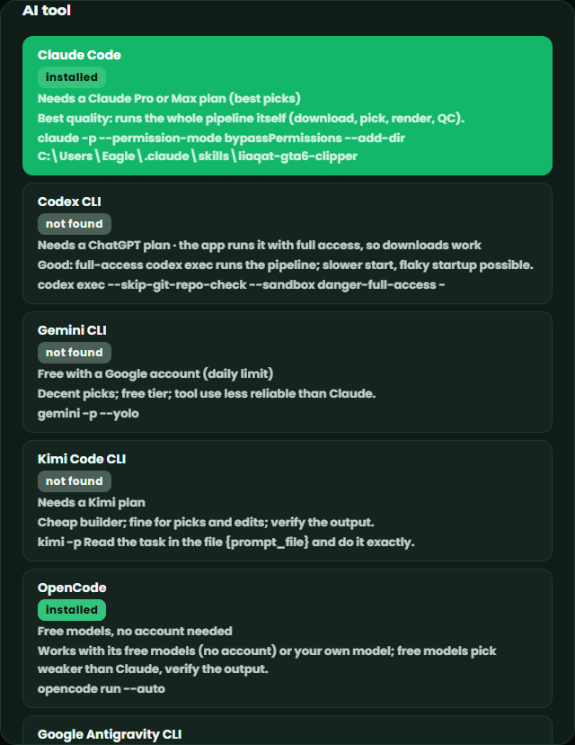<br><b>Any AI tool.</b> Claude Code, Codex, Gemini, Kimi, <b>OpenCode</b> (works on its free models), Ollama, your own command, or No AI.</td>
</tr>
<tr>
<td colspan="2">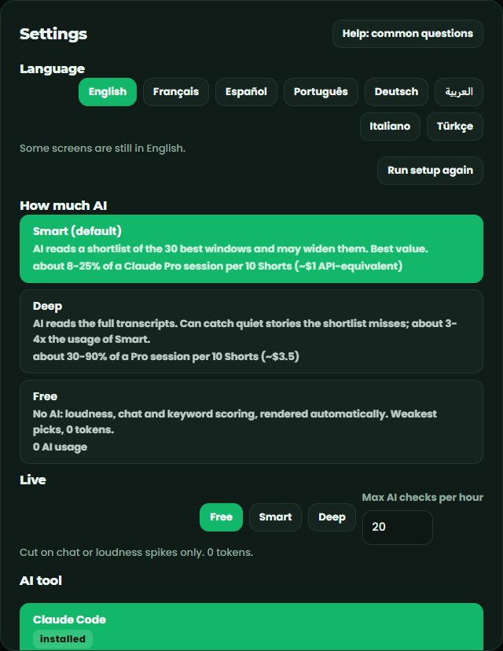<br><b>Settings.</b> Language and how much AI to use.</td>
</tr>
</table>

## One video in, Shorts out

Give it a link or a video file on your PC. It transcribes it, labels chases, crashes and loud moments, and cuts the best ones into 9:16 Shorts. A real run on one xQc GTA 6 stream:

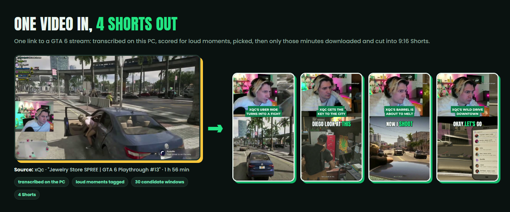

## Live hunt: many streams at once

Tick "Watch live" on a streamer and the app records the stream, watches chat speed and loudness, and cuts a Short the moment chat spikes.

- **Spike detection:** a chat spike is a few times the stream's own baseline, so a quiet streamer and a huge one are judged fairly.
- **Setup first:** the Short starts 17-20 s before the spike so the viewer sees what caused it.
- **Up to 60 s,** because real viral moments run 6 to 61 s.
- **Credit built in:** every Short carries a credit line to the streamer in its post text.

<p align="center">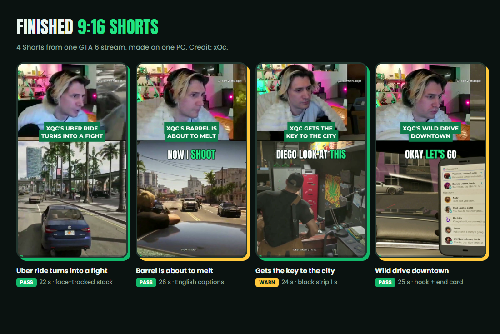</p>

## What you can type

| Prompt | What happens |
|---|---|
| `make 10 GTA 6 Shorts` | Finds the newest GTA 6 videos, picks the best moments and renders up to 10 Shorts |
| `make Shorts from <link>` | Same, from one YouTube, Twitch or Kick video |
| `clip <streamer> live` | Records the stream and cuts a Short on every chat spike |
| `add my voice to this clip` | Adds your own voice-over to a finished Short |
| `open the clipper app` | Opens the web app with all your Shorts |

## How much AI

Transcription, framing, captions and rendering run on your PC for free. Only the choice of moments can use AI. Measured on a real run (usage is a share of one Claude Pro session):

| Mode | What picks the moments | Cost per 10 Shorts |
|---|---|---|
| Free | Loudness, chat and keyword scoring. Weakest picks | 0 |
| Smart (default) | AI reads a shortlist of the 30 best windows and may widen them | about 8-25% of a Claude Pro session |
| Deep | AI reads the full transcripts; catches quiet stories | about 30-90% of a Claude Pro session |
| Live spike (optional AI check) | AI looks at one chat spike | about 1-4% of a session |

Live hunt defaults to Free (no AI) with a cap on AI checks per hour. Your Claude plan is the only thing used; no API keys are needed.

## What it does not do yet

- It does not know what will go viral. It finds loud, chat-heavy moments and ranks them; you decide what to approve.
- It does not post, schedule or upload anything. It only makes clips.
- Live hunt on a weak PC is limited to a few streams at once; recording 8 needs a strong machine and a good connection.
- Some Shorts fail the built-in quality check (too short, no speech); the app marks them so you can skip or fix them.

## FAQ

**Is it free?** Yes. The tool is free; Claude Code runs on your own Claude plan.

**Who owns the clips?** The streamers do. Credit them and respect their rules; see [NOTICE.md](NOTICE.md).

**Does it work without an AI?** Yes, Free mode scores loudness, chat and keywords and renders automatically.

## License

MIT, see LICENSE. Bundled fonts keep their own OFL licenses (`fonts/`); models are listed in `models/NOTICES.txt`.

## Credits

Learn With Liaqat edition for [Learn With Liaqat](https://www.youtube.com/@LearnWithLiaqat). Based on gta6-clipper by [NoCodeHack](https://www.youtube.com/@nocodehack) (MIT), built with Claude Code. Uses ffmpeg, faster-whisper, yt-dlp, streamlink, OpenCV and MediaPipe. Streamers in the images are credited on the clips they appear in. Fan-made, not affiliated with Rockstar Games, Take-Two or any streamer.
